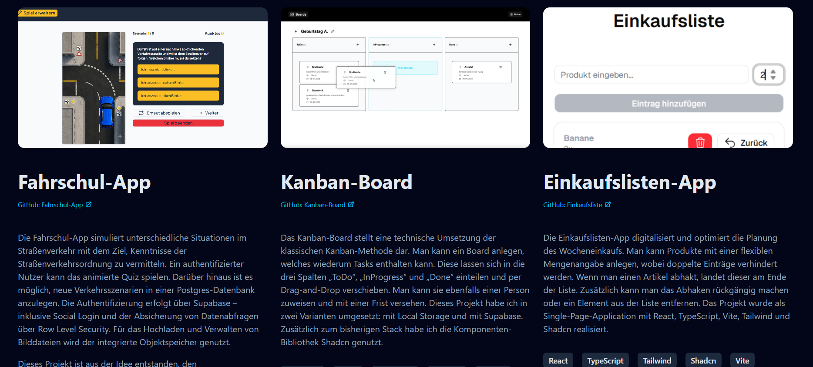

# Portfolio-Website



Eine responsive und modern gestaltete Portfolio-Website für meine persönliche Präsentation als Frontend Web Developerin. Die Website dient als digitale Visitenkarte, stellt relevante Kernkompetenzen dar und bietet eine strukturierte Übersicht über von mir realisierte Softwareprojekte.

## Voraussetzungen
Für die lokale Ausführung und das Kompilieren des Projekts werden folgende Komponenten benötigt:
* Node.js (aktuelle LTS-Version)
* Ein moderner Webbrowser
* Git (optional, falls Sie das Repository klonen möchten)

## Technologien
* **HTML5:** Semantische Gliederung der Sektionen (`<main>`, `<section>`, `<figure>`, `<footer>`) zur Gewährleistung der Barrierefreiheit.
* **Tailwind CSS:** Utility-First-CSS-Framework für ein performantes, responsives Oberflächen-Design, inklusive fortgeschrittener CSS-Effekte wie Textmaskierung und Farbverläufen.
* **Vite:** Performantes Frontend-Build-Tool für eine schnelle Entwicklungsumgebung und optimierte Produktions-Builds.

## Technische Funktionsweise

Die Portfolio-Website wurde als performante und datenschutzkonforme Landingpage realisiert:

### Responsive Grid-Architektur und Navigation
* **Flüssiges Scrollverhalten:** Das Dokument nutzt die CSS-Klasse `scroll-smooth` zur Umsetzung einer fließenden Navigation, bei der Benutzer über Sprungmarken nahtlos zu den Projekt-Showcases (`#projects`) oder zur Kontaktaufnahme geleitet werden.
* **Adaptive Komponenten:** Die Benutzeroberfläche passt sich über Tailwind-Breakpoints flexibel an mobile und stationäre Endgeräte an. Das Layout schaltet in der Hero-Sektion autonom von einer mobilen Spalte (`flex-col`) in eine Desktop-Zeile (`lg:flex-row`) um. Die Projektauswahl ist in einem mehrspaltigen Grid-System organisiert (`grid-cols-1 md:grid-cols-2 lg:grid-cols-3`).
* **Typografische Akzente:** Zur Hervorhebung zentraler Qualifikationen wird ein präzise maskierter linearer Farbverlauf (`bg-linear-to-r from-sky-400 to-emerald-600 bg-clip-text text-transparent`) eingesetzt.

### Integrierte Projekt-Showcases
Die Webseite präsnetiert meine praktischen Frontend-Fähigkeiten. Jedes Projekt wird modular mit detaillierten Beschreibungen, Live-Verlinkungen und Badge-Containern für den Tech-Stack präsentiert:

* **Fahrschul-App:** Interaktives Quiz-System auf Basis von React, TypeScript und Shadcn. Es demonstriert die Anbindung an eine relationale Postgres-Datenbank via Supabase-Infrastruktur inklusive Social-Login-Authentifizierung, Objektspeicher-Anbindung und Absicherung über Row Level Security (RLS).
* **Kanban-Board:** Technische Umsetzung der klassischen agilen Projektmanagementmethode. Beinhaltet ein dreispaltiges Layout mit dynamischer Drag-and-Drop-Verschiebung von Tasks, Fristenverwaltung und Personen-Zuweisung. 
* **Einkaufslisten-App:** Single-Page-Application zur Einkaufsoptimierung mit flexiblen Mengenangaben, einer case-insensitiven Duplikatsprüfung im Zustandssystem sowie einer automatischen, reaktiven Neusortierung erledigter Einträge an das Listenende.
* **User-Übersicht:** Eine strukturierte CRUD-Anwendung zur Erfassung und Verwaltung von Nutzerdaten. Sie enthält eine Eingabemaske mit clientseitiger Validierung auf Vollständigkeit sowie editier- und löschbare Benutzeroberflächen-Karten (User-Cards) auf Basis von React, TypeScript und SCSS.
* **To-Do-App:** Eine Single-Page-Application zur digitalen Organisation täglicher Aufgaben. Sie implementiert ein interaktives Text-Eingabefeld, ein komponentenbasiertes UI-Rendering und ein zentrales Zustandsmanagement mittels React-Hooks.
* **Wetter-App:** Eine moderne Webapplikation zum Abruf weltweiter Echtzeit-Wetterdaten über asynchrone API-Abfragen. Die Logik beinhaltet das Verwalten einer clientseitig editierbaren Favoritenliste und ein speziell für mobile Endgeräte optimiertes SCSS-Layout (Mobile First).
* **Witze-App:** Webanwendung zum Abruf von Witzen unterschiedlicher Kategorien über eine öffentliche API-Schnittstelle. Das Projekt demonstriert ein responsives SCSS-Design mit einem flexiblen, dynamischen Farbschema (Color-Scheme), welches sich autonom an Systempräferenzen anpasst oder per Benutzerinteraktion umgeschaltet werden kann.
* **Notiz-App:** Digitale Variante eines klassischen Notizblocks zur flexiblen Verwaltung von Notizen. Das System bietet Formatierungsklassen zur Kategorisierung (Pflicht/Freizeit) und Priorisierung (Rahmen-Zuweisung) von Karten. Zudem ist ein Schutz gegen Cross-Site-Scripting (XSS) eingebaut. Die Speicherung der Daten erfolgt im *Local Storage*. 
* **Thermen-Website:** Mehrseitiger Webauftritt einer fiktiven Therme („Stille Oase“). Die technische Umsetzung erfolgt nativ über HTML5 und CSS3. Sie demonstriert strukturierte, responsive Layout-Raster mittels CSS-Grid und Flexbox sowie eine intuitive One-Page-Navigation.

### Datenschutzkonformes Konzept (Privacy-First)
* **Reine statische Hyperlinks:** Das Verknüpfen externer Plattformen (LinkedIn, GitHub) erfolgt ausschließlich über einfache Hyperlinks. Im Gegensatz zu Iframe-Plug-ins werden beim reinen Laden der Seite keinerlei Benutzerdaten an Drittanbieter übertragen.
* **Vollständiger Verzicht auf Tracker:** Die Website verwendet keine Cookies, keine Analysedienste (wie Google Analytics) und bindet keine externen Schriftarten-Server (CDNs) ein.
* **Rechtssicheres Hosting:** Die Anwendung wird statisch über GitHub Pages bereitgestellt. Unumgängliche Server-Logfiles (IP-Adresse) zur Angriffsabwehr und Performance-Optimierung sind über das berechtigte Interesse nach Art. 6 Abs. 1 lit. f DSGVO abgedeckt. Die Übermittlung in Drittländer wird über die EU-Standardvertragsklauseln von GitHub abgesichert.

## Installation
Klonen Sie das Projekt auf Ihren lokalen Computer und installieren Sie die erforderlichen Abhängigkeiten über den Paketmanager:

```bash
# Repository klonen
git clone https://github.com

# In den Projektordner navigieren
cd portfolio-website

# Abhängigkeiten installieren
npm install
```

## Nutzung
1. Starten Sie den lokalen Vite-Entwicklungsserver mit folgendem Befehl:
   ```bash
   npm run dev
   ```
2. Öffnen Sie die in der Konsole angezeigte lokale URL (Standard: `http://localhost:5173`) in Ihrem Webbrowser.


## Deployment
Die Website kann direkt über GitHub Pages gehostet werden:
1. Gehen Sie auf GitHub in die Settings Ihres Repositories.
2. Klicken Sie im linken Menü auf Pages.
3. Wählen Sie unter Build and deployment den `main` (oder `master`) Branch aus und klicken Sie auf Save.
4. Nach wenigen Minuten ist die Website live unter Ihrer GitHub-Pages-URL erreichbar.


## Lizenz
Dieses Projekt wurde von Xenia Wilczek erstellt. Alle Rechte an Code und Design vorbehalten (All Rights Reserved).
